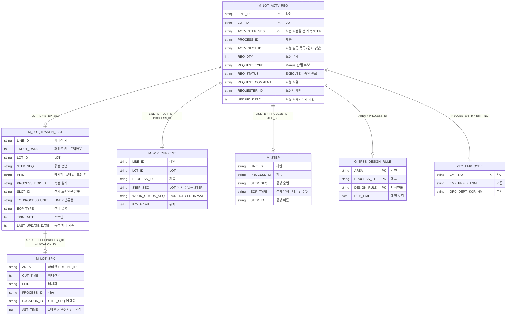

# ERD — 계측 사전 지정 부하 모니터

조회에 쓰는 테이블과 연결 관계. **읽기 전용이다.** 이 프로그램은 어떤 테이블에도 쓰지 않는다.

> 테이블 정의는 사내 DB 를 기준으로 한다. 함께 받은 컬럼 정리표는 사진·메모
> 재구성본이라 실제와 다를 수 있다. 의심되면 `SELECT * FROM <테이블> LIMIT 5` 로 본다.

---

## 1. 전체 관계



---

## 2. 테이블별 역할

| # | 테이블 | 역할 | 없으면 |
|---|---|---|---|
| 기준 | `fab.m_lot_actv_req` | 사전 지정 요청. 모든 행의 출발점 | 아무것도 안 됨 |
| 1 | `fab.m_lot_transn_hist` | PPID · 트랙인 · 실제 슬롯 | 실적 확인 불가 |
| 2 | `fab.m_lot_spx` | **1매 측정시간** (`AST_TIME`) | 총측정시간 계산 불가 |
| 3 | `fab.g_tpss_design_rule_record` | 디자인룰 → LINEP 분류 | 라인 분류가 LINE_ID 그대로 |
| 4 | `dscrm_ds.crmadmin_if_zto_employee` | 요청자 이름 · 부서 | 부서별 집계 불가 |
| 5 | `fab.m_wip_current` | LOT 의 **현재 STEP** | 사전 지정까지 얼마나 남았는지 모름 |
| 6 | `fab.m_step` | STEP 마스터 (EQP_TYPE) | **대기 건의 설비 유형이 빔** |

5·6 은 "아직 측정 안 한 대기 건"을 쓸 수 있게 하는 조인이다. 사전 관리가 목적이면
대기 건이 핵심이므로 빼면 안 된다.

---

## 3. 키 — 성능과 정확도에 직결

| 테이블 | 키 | 종류 |
|---|---|---|
| `m_lot_transn_hist` | `LINE_ID`, `TKOUT_DATA` | **파티션 키** |
| `m_lot_spx` | `AREA`, `OUT_TIME` | **파티션 키** |
| `g_tpss_design_rule_record` | `AREA`, `PROCESS_ID`, `DESIGN_RULE` | **PK** |

### 3.1 파티션 키를 WHERE 에 안 걸면

팹 전체 이력을 읽는다. 특히 `m_lot_transn_hist` 는 그 위에 윈도우 함수를 돌리므로
수십 초가 걸린다. **기간을 `TKIN_DATE` 로 거르면 파티션 가지치기가 안 된다.**
반드시 `TKOUT_DATA` 로 건다.

```sql
WHERE ( H.TKOUT_DATA >= DATE_SUB(:d_from, INTERVAL 8 DAY)
        OR H.TKOUT_DATA IS NULL )          -- ★ 이 줄이 빠지면 안 된다
  AND H.LINE_ID IN (SELECT DISTINCT LINE_ID FROM REQ_BASE)
```

`TKOUT_DATA IS NULL` 을 같이 두는 이유: 지금 설비에 올라가 있는(트랙인 했고 아직
트랙아웃 안 한) LOT 이 바로 실시간 관제 대상인데, 범위 조건만 쓰면 그 행이 통째로 빠진다.

### 3.2 AREA 를 조인 키에서 빼면

`AREA` 는 다른 테이블의 `LINE_ID` 와 같은 값이다. 빼면 **같은 제품을 여러 라인에서
돌릴 때 다른 라인 값이 붙는다.**

실제로 확인한 증상 (제품 KGVL 을 PFBP·PFBB 두 라인에서 돌리는 경우):

| | AREA 뺐을 때 | AREA 넣었을 때 |
|---|---|---|
| PFBP LOT 의 DESIGN_RULE | PFBB 의 `D20` | `C10` |
| → LINEP 분류 | `P1D` (틀림) | `P1F` |
| 1매 ST | 25분 (라인 섞인 평균) | 10분 |

라인 분류와 예상 시간이 **동시에** 틀린다.

---

## 4. 조인 카디널리티

Spotfire 의 **Left single match join** 은 여러 건이 맞아도 1건만 붙인다.
SQL 에는 같은 조인이 없으므로 오른쪽을 키당 1행으로 줄인 뒤 LEFT JOIN 한다.

| 조인 | 원래 | 줄이는 방법 | 안 줄이면 |
|---|---|---|---|
| `m_lot_transn_hist` | 1 : N (재측정) | `ROW_NUMBER()` 최근 트랙인 1건 | 재측정 LOT 에서 행 증식 → 총측정시간 과대 |
| `m_lot_spx` | 1 : N (실적 다수) | `GROUP BY` + `AVG` | 〃 |
| `g_tpss_design_rule_record` | 1 : N (PK 에 DESIGN_RULE) | `ROW_NUMBER()` 최신 `REV_TIME` 1건 | 〃 |
| `crmadmin_if_zto_employee` | 1 : 1 (사번) | 중복 대비 1행 | 사번 중복 시 행 증식 |
| `m_wip_current` | 1 : 1 (추정) | 1행으로 축약 | 유일성 미확인이라 방어 |
| `m_step` | 1 : 1 (마스터) | 1행으로 축약 | 〃 |

**행 증식은 조용히 틀린다.** 에러가 안 나고 합계만 부풀려진다.
DB 붙인 직후 조인 전후 행 수를 비교해 같은지 확인한다.

---

## 5. 파생 값

SQL 에서 계산해 내보내는 것들. 원본 컬럼이 아니다.

| 출력 | 식 | 비고 |
|---|---|---|
| `SLOT_COUNT` | `LENGTH(NULLIF(SLOT_ID,'')) - LENGTH(REPLACE(...,',','')) + 1` | 실제 트랙인 슬롯 수 |
| `REQ_SLOT_COUNT` | 같은 식을 `ACTV_SLOT_ID` 에 | **요청** 슬롯 수 |
| `AVG_APT` | `AVG(AST_TIME)` (PPID 단위) | 1매 ST |
| `AVG_APT_STEP` | `AVG(AST_TIME)` (STEP 단위, PPID 제외) | 대기 건 받침 |
| `AVG_APT_USED` | `COALESCE(AVG_APT, AVG_APT_STEP)` | 실제로 쓰는 값 |
| `FORECAST_APT` | `AVG_APT × SLOT_COUNT` | 실적 확인용. 대기 건은 빔 |
| `FORECAST_APT_REQ` | `AVG_APT_USED × REQ_SLOT_COUNT` | **사전 관리용. 이걸 쓴다** |
| `LINEP` | `LINE_ID` + `TO_PROCESS_UNIT` + `DESIGN_RULE` 조합 | 라인 분류 |
| `계측유무` | TKIN 있음 / 재공에 있음 / 그 외 | TKIN 현황 · 대기 현황 · 완료·제외 |
| `측정상태` | TKIN·TKOUT 조합 | 대기 · 측정중 · 완료 |
| `STEP_도달` | `CUR_STEP_SEQ` vs `ACTV_STEP_SEQ` | 해당 STEP · 다른 STEP · 재공 없음 |

`NULLIF(SLOT_ID,'')` 가 빠지면 안 된다. MySQL 은 빈 문자열이 NULL 이 아니라
빈 슬롯이 0매가 아니라 **1매로 세진다.** 총측정시간이 부풀려지고 알람이 오탐한다.

---

## 6. 확인해야 할 것

| 항목 | 왜 |
|---|---|
| `AST_TIME` 이 1매 평균이 맞는가 | 아니면 모든 시간 계산이 무의미 |
| `AST_TIME` 의 단위 (분/초) | 60배 어긋난다 |
| `REQUEST_TYPE` 코드값 | Manual 판별 기준. 주차별 3화면의 전제 |
| `ACTV_SLOT_ID` 표기법 | 쉼표 구분이 아니면 매수 집계가 틀린다. `REQ_QTY` 와 대조 |
| `m_wip_current` 가 LOT 당 1행인가 | 아니면 행 증식 |
| `fab.*` 를 MySQL 로 읽는가 bdq 로 읽는가 | bdq 면 SQL 방언을 다시 맞춰야 한다 |
